# VEX AI — Complete Dashboard System Design & UI/UX Expert Specification

> **Document Classification:** Principal UI/UX Design System & Frontend Architecture Blueprint  
> **Application:** VEX AI Career Co-Pilot (`Next.js 16.2` · `React 19` · `Tailwind CSS v4` · `Framer Motion 12`)  
> **Viewport Standard:** `1440 × 950` Desktop Reference + Adaptive Mobile Drawer Shell  
> **Folder Location:** `./new vex designs dashbard`

---

## 1. Executive UI/UX Design Philosophy

**VEX AI** is engineered around a **"Warm Editorial Glass & High-Contrast Neo-Brutalist"** design language. Unlike sterile enterprise SaaS dashboards that rely on cold slate grays and generic thin typography, VEX AI pairs an inviting warm alabaster canvas (`#F9F7F2`) with deep obsidian surfaces (`#111111`), electric lime-gold accents (`Primary`), and ultra-heavy display typography (`font-[900]`, tight `-0.04em` tracking).

### Core UX Pillars
1. **Zero-Friction Cognitive Hierarchy:** Every screen anchors the user with an oversized `text-4xl font-[900]` header paired with a soft `rounded-xl bg-primary/10` icon badge, immediately communicating context within `150ms` of route transition.
2. **Tactile Spatial Containers:** Content cards utilize generous `rounded-[2rem]` (`32px`) border radii, subtle `1px` translucent borders (`border-black/5 dark:border-white/5`), and ambient radial glow blurs (`blur-3xl bg-primary/10`) to establish depth without visual clutter.
3. **Action-First AI Co-Piloting:** Complex AI workflows (ATS keyword scanning, bullet-point metric rewriting, autonomous job application loops, and Manus company research) are distilled into single-click primary triggers with real-time visual telemetry.
4. **Resilient Demo-First State Architecture:** Every module operates seamlessly with optimistic client state and instant AI simulation fallbacks, ensuring zero loading dead-ends.

---

## 2. System Architecture & User Flow Topology

### 2.1 High-Level Frontend & API Architecture

```mermaid
flowchart TB
    subgraph Client["Next.js 16 App Router — Client Shell (/app/*)"]
        Shell["AppLayout (Sidebar + Backdrop Header + FeatureIntro)"]
        State["Interactive Demo State & Optimistic UI Engine"]
        Motion["Framer Motion 12 Layout & Spring Transitions"]
    end

    subgraph Modules["15 Core Career Acceleration Modules"]
        M1["01. Dashboard Command Center"]
        M2["02. AI Job Matches Engine"]
        M3["03. Kanban Application Board"]
        M4["04. Autonomous Auto-Apply Bot"]
        M5["05. AI Resume Sandbox Builder"]
        M6["06. ATS Keyword & Section Scanner"]
        M7["07. Tailored Cover Letter Studio"]
        M8["08. Mock Interview & Manus Agent"]
        M9["09. Skill Learner Hub"]
        M10["10. AI Career Roadmap"]
        M11["11. Public Project Portfolio"]
        M12["12. Real-Time Recruiter & Coach Chat"]
        M13["13. Smart Notification Center"]
        M14["14. Profile & Workspace Settings"]
        M15["15. Pro Billing & Credit Telemetry"]
    end

    subgraph Backend["Hybrid Data & AI Layer (/api/*)"]
        Auth["Session & Demo Fallback Middleware (proxy.ts + lib/auth.ts)"]
        API["REST & Streaming Route Handlers"]
        DB[("PostgreSQL / Prisma ORM + Offline Demo Store")]
    end

    Shell --> State
    State --> Motion
    Motion --> Modules
    Modules --> Auth
    Auth --> API
    API --> DB
```

### 2.2 End-to-End Career Acceleration Loop

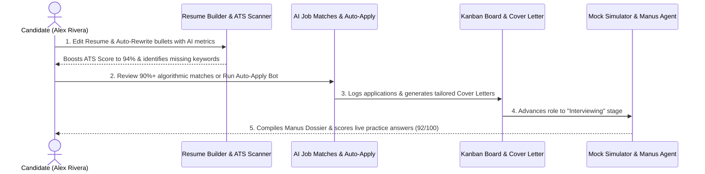

---

## 3. UI/UX Design Token Specification

| Token Category | Token Name | Light Mode Value | Dark Mode Value | UX Purpose & Application |
| :--- | :--- | :--- | :--- | :--- |
| **Canvas** | `bg-canvas` | `#F9F7F2` (Warm Alabaster) | `#0A0A0A` (Deep Carbon) | Reduces eye strain during long job-search sessions |
| **Surface** | `bg-card` | `#FFFFFF` / `rgba(255,255,255,0.5)` | `#111111` / `#1A1A1A` | Primary elevated card containers with `backdrop-blur-xl` |
| **Brand Primary** | `bg-primary` | Electric Accent / Brand Gold-Lime | Electric Accent / Brand Gold-Lime | Primary CTAs, active nav pills, progress rings, AI badges |
| **Brand Secondary** | `bg-secondary` | Deep Ink Charcoal | Crisp White | High-contrast secondary actions & typographic anchors |
| **Semantic Status** | `status-*` | Emerald `#10B981` · Amber `#F59E0B` · Rose `#F43F5E` | Translucent `10%` fills + vibrant text | Instant scannability for match scores & pipeline stages |
| **Border Radius** | `rounded-[2rem]` | `32px` outer / `16px` inner controls | `32px` outer / `16px` inner controls | Signature friendly, modern hardware-inspired curvature |
| **Typography** | Display / Body | `font-[900]` headers · `font-bold` controls | `tracking-tight` (`-0.03em`) | Editorial authority and scannable data density |

---

## 4. Complete Visual Gallery & UI/UX Expert Breakdown (All 15 Views)

### 4.1 Dashboard Command Center (`/app`)
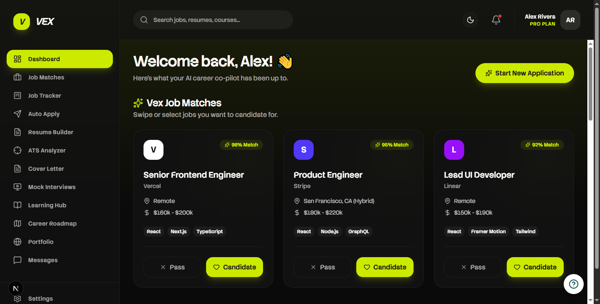

* **UX Architecture:** Serves as the candidate's daily mission control. The top fold features **Vex Job Matches** (interactive 3-card quick-triage deck with match percentage badges and `Pass` / `Candidate` triggers).
* **Visual Telemetry:** Below the fold, a **Profile Strength Radial Gauge (`85% Excellent`)** pairs with a 3-stage vertical bar **Application Pipeline (`12 Applied`, `4 Interviewing`, `1 Offer`)**, a 6-card **Quick Actions** bento grid, a vertical timeline **AI Activity Feed**, and **Skill Learner** recommendations.

---

### 4.2 AI Job Matches (`/app/jobs/matches`)
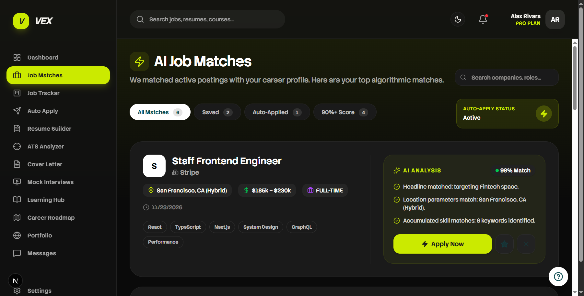

* **UX Architecture:** Splits each job listing into a dual-pane card: **Left Pane** presents role metadata (`Staff Frontend Engineer` at `Stripe`, location, salary band `$185k – $230k`, and skill pills), while the **Right Pane** highlights an **AI Analysis** box explaining *why* the candidate matched (`98% Match`).
* **Micro-Interactions:** Filter pills (`All Matches`, `Saved`, `Auto-Applied`, `90%+ Score`) dynamically recalculate counts, while 1-click `Apply Now`, `Star`, and `Dismiss (X)` buttons provide instant optimistic feedback.

---

### 4.3 Application Board — Kanban Tracker (`/app/jobs/tracker`)
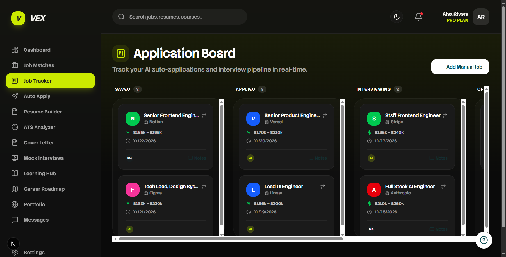

* **UX Architecture:** A 5-column horizontal Kanban workspace (`Saved`, `Applied`, `Interviewing`, `Offered`, `Rejected`) engineered for full-viewport spatial clarity (`h-[calc(100vh-140px)]`).
* **Card Anatomy:** Each card displays a color-hashed company monogram, salary range, timestamp, an attribution badge (`AI` vs `Me`), and an instant `Move To` stage-transition popover menu alongside a `+ Add Manual Job` modal.

---

### 4.4 Autonomous Auto-Apply Agent (`/app/auto-apply`)
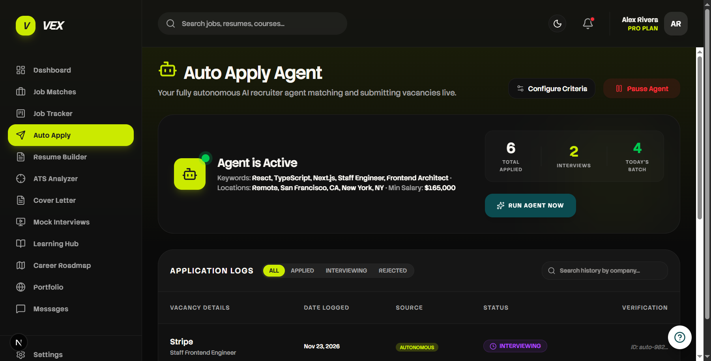

* **UX Architecture:** Combines an executive **Agent Status Banner** (showing active search keywords, target locations, `$165,000` minimum salary floor, and live counters for `Total Applied`, `Interviews`, and `Today's Batch`) with a filterable **Application Logs** audit table.
* **Interactive Simulation:** Clicking **Run Agent Now** engages an animated concentric radar scanner that matches and logs 3 new autonomous applications (`OpenAI`, `Supabase`, `Datadog`) in real time.

---

### 4.5 AI Resume Builder (`/app/resume-builder`)
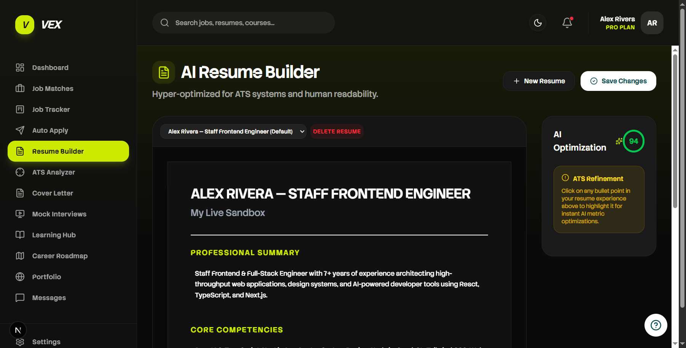

* **UX Architecture:** A 3:1 split workspace featuring a distraction-free **WYSIWYG Resume Canvas** on the left and an **AI Optimization Co-Pilot Sidebar** on the right (displaying the live `94` ATS score ring).
* **Contextual AI Rewriting:** Clicking any work-experience bullet highlights it in amber and unlocks the **Auto-Rewrite Highlighted** wand, injecting quantified business metrics and incrementing the resume's ATS score on the spot.

---

### 4.6 ATS Score Analyzer (`/app/ats-analyzer`)
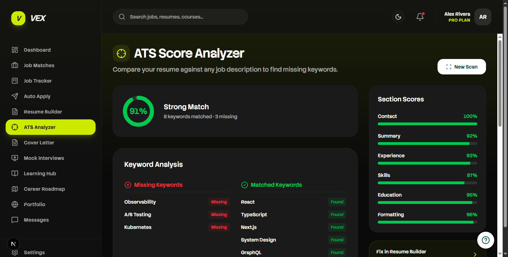

* **UX Architecture:** Transforms opaque ATS filtering into transparent, actionable diagnostics. After scanning a resume against a target job description, the view transitions to a **91% Strong Match** dashboard.
* **Diagnostic Breakdown:** Side-by-side **Missing vs. Matched Keywords** lists pair with priority-coded **AI Suggestions** (`high` in rose, `medium` in blue) and 6 granular **Section Score Progress Bars** (`Contact 100%`, `Formatting 96%`, `Education 95%`, `Experience 93%`, `Summary 92%`, `Skills 87%`).

---

### 4.7 Cover Letter Generator (`/app/cover-letter`)
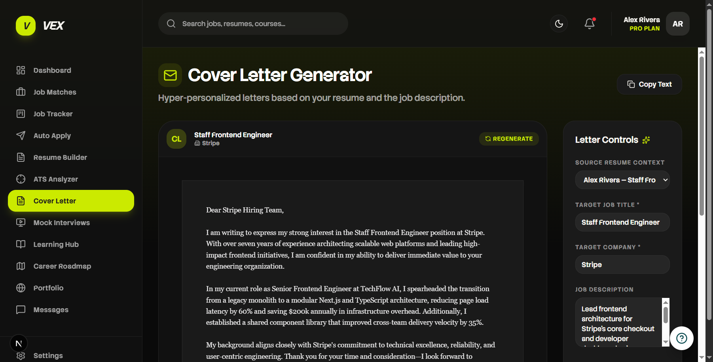

* **UX Architecture:** Pairs a serif-typeset **Live Letter Document Preview** (`700px` paper container) with a right-hand **Letter Controls** panel.
* **Tone & Personalization Engine:** Users switch between `Professional formal`, `Startup Hustle`, and `Creative Story` tones, select source resume context, add custom prompt instructions, and regenerate or copy the tailored letter in one click.

---

### 4.8 AI Mock Interviews & Manus Research Agent (`/app/interview-prep`)
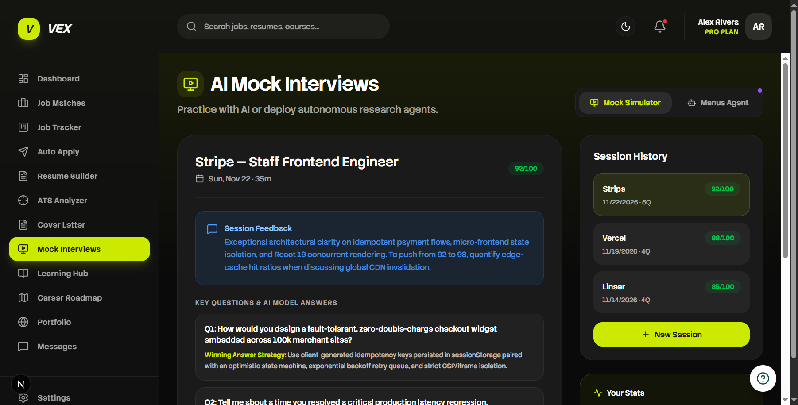

* **UX Architecture:** Features a dual-mode segmented toggle in the top right: **Mock Simulator** and **Manus Agent**.
* **Interactive Simulator:** Displays past session scores (`92/100` for `Stripe — Staff Frontend Engineer`), expandable **Key Questions & AI Model Answers**, and an embedded **Interactive Practice Answer Simulator** that evaluates typed responses with instant STAR-method scoring. Switching to **Manus Agent** deploys an autonomous terminal logger that compiles a full company technical briefing dossier.

---

### 4.9 Skill Learner Hub (`/app/learning-hub`)
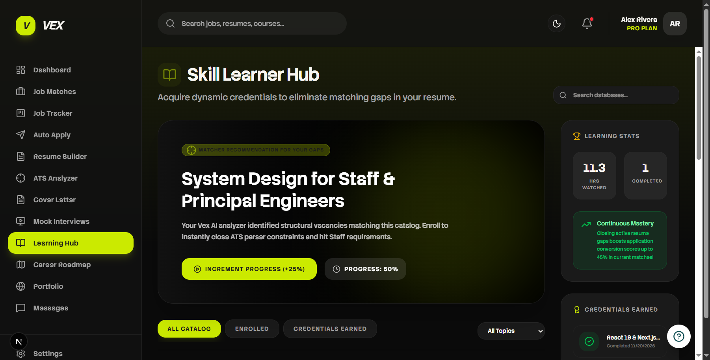

* **UX Architecture:** Anchored by a high-contrast dark hero banner (**Matcher Recommendation for your Gaps**) that links resume keyword deficiencies directly to curated upskilling courses.
* **Gamified Progression:** Each course card features vibrant gradient headers, module/duration metadata, and interactive `+25% Progress` / `Complete` controls that dynamically update the right-hand **Learning Stats** (`Hrs Watched`, `Completed`) and **Credentials Earned** certificates.

---

### 4.10 AI Career Roadmap (`/app/career-roadmap`)
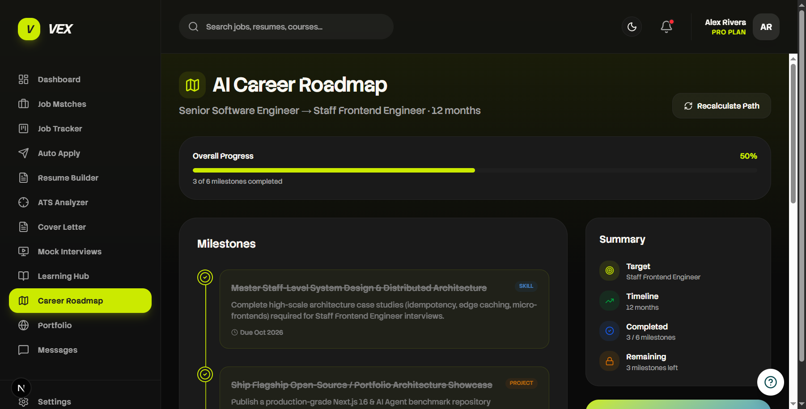

* **UX Architecture:** Visualizes long-term career progression (`Senior Software Engineer → Staff Frontend Engineer · 12 months`) through a top **Overall Progress Bar (`50%`)** and a vertical connected **Milestones Timeline**.
* **Interactive Milestone Tracking:** Each node is color-coded by category (`skill`, `project`, `application`, `certification`, `networking`) and can be toggled complete/incomplete with instant progress bar recalculation, or regenerated for any custom role pair via **Recalculate Path**.

---

### 4.11 Project Portfolio (`/app/portfolio`)
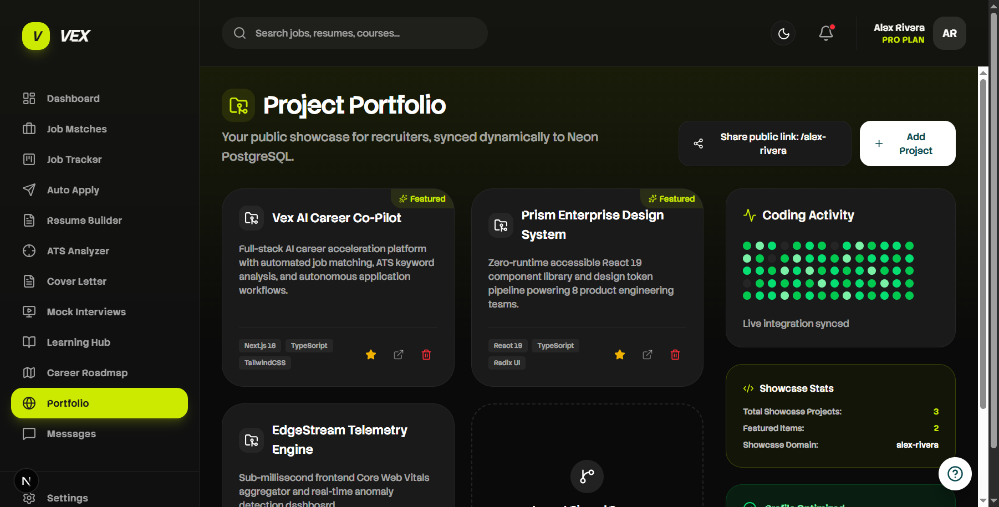

* **UX Architecture:** A recruiter-ready showcase manager displaying featured project cards (`Vex AI Career Co-Pilot`, `Prism Enterprise Design System`, `EdgeStream Telemetry Engine`) alongside a GitHub-style **Coding Activity Heatmap** and **Showcase Stats** sidebar.
* **Seamless Curation:** Includes 1-click **Featured Star** pinning, a `+ Add Project` modal, and an interactive **Import Pinned Repos** card that syncs GitHub repositories directly into the grid.

---

### 4.12 Messages & AI Career Coach (`/app/messages`)
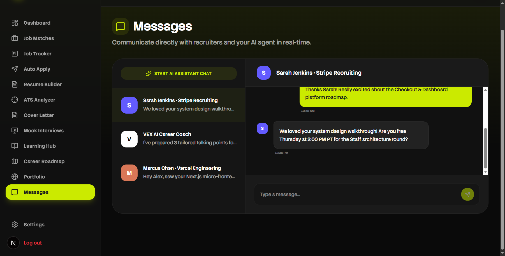

* **UX Architecture:** A full-height split-pane messaging client (`380px` conversation list + active thread window) uniting human recruiter outreach (`Sarah Jenkins • Stripe Recruiting`, `Marcus Chen • Vercel Engineering`) with the **VEX AI Career Coach**.
* **Simulated Real-Time Replies:** Sending any message appends optimistically to the timeline and triggers a context-aware recruiter or AI Career Coach response within `900ms`.

---

### 4.13 Smart Notifications (`/app/notifications`)
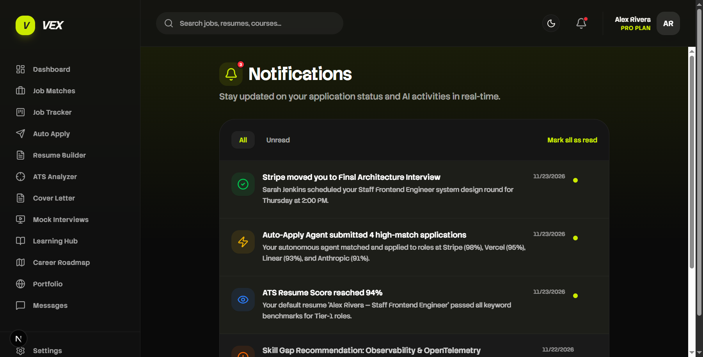

* **UX Architecture:** A focused `800px` centered activity stream with `All` / `Unread` segmented filtering, semantic icon badges (emerald for interview invites, amber for AI auto-apply batches, blue for ATS milestones), and 1-click `Mark all as read` hygiene.

---

### 4.14 Settings & Interactive Profile (`/app/settings`)
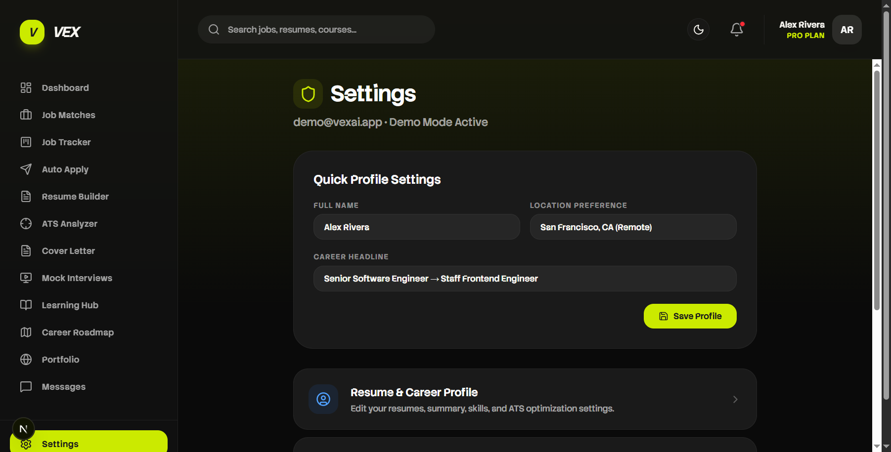

* **UX Architecture:** Combines an inline **Quick Profile Settings** editor (allowing instant updates to `Full Name`, `Location Preference`, and `Career Headline` in Demo Mode) with clean navigation cards to Resume Profile, Billing, Integrations, and Notifications.

---

### 4.15 Billing, Plans & AI Credit Telemetry (`/app/settings/billing`)
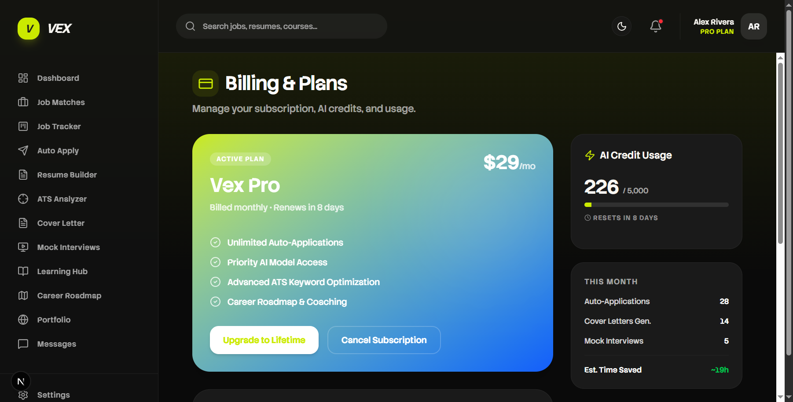

* **UX Architecture:** Highlights the active **Vex Pro (`$29/mo`)** subscription card with a vibrant gradient backdrop, paired with a right-hand **AI Credit Usage** meter (`236 / 5,000 credits`), monthly ROI telemetry (`28 Auto-Applications`, `14 Cover Letters`, `5 Mock Interviews`, `~19h Est. Time Saved`), and lifetime usage counters.
