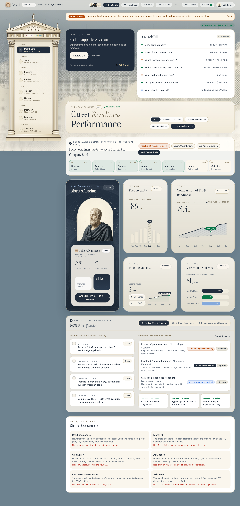
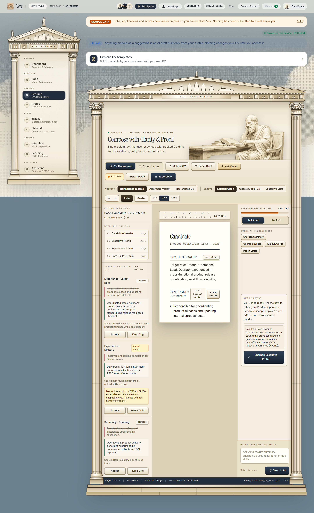
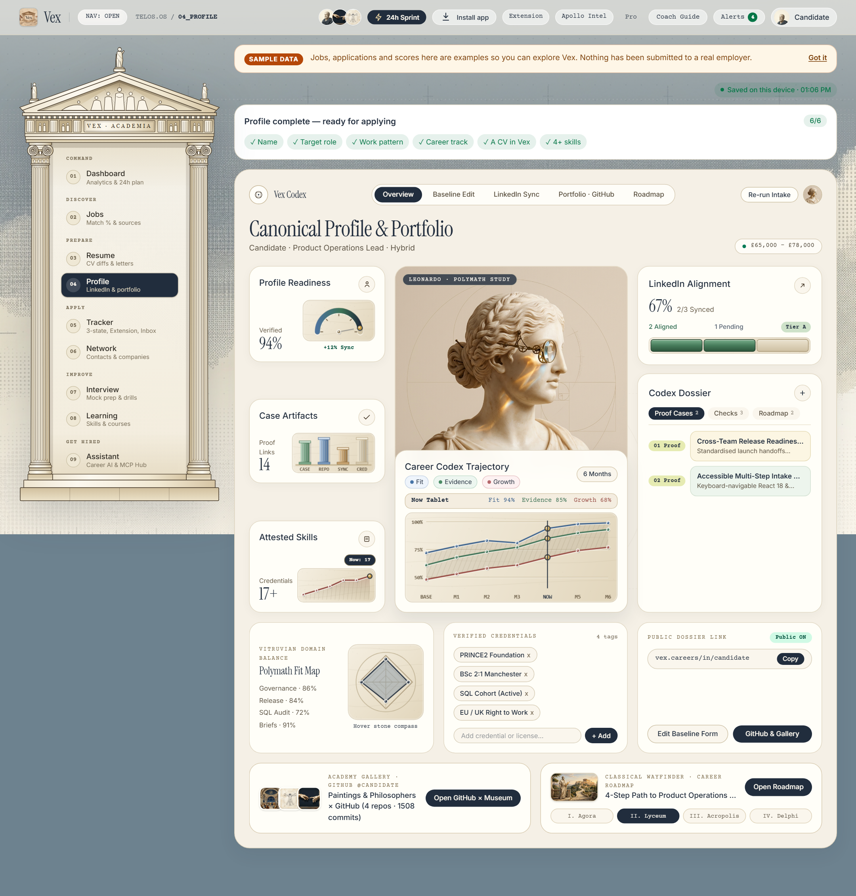

# VEX — Complete UI/UX Design System & Feature Showcase

> **Design Identity:** *Athenian Philosophical Academy meets Apple HIG Precision*  
> **Architecture:** Dual-Surface Single-State Workspace (`Next.js 15 App Router` · `React 19` · `TypeScript` · `Tailwind CSS v4` · `Framer Motion`)  
> **Breakpoints:** Desktop Command Sanctuary (`lg: >= 1024px`) · Mobile Liquid-Glass iOS Companion (`< lg: < 1024px`)

---

## Table of Contents

1. [Executive Design Philosophy](#1-executive-design-philosophy)
2. [Design System Foundations & Tokens](#2-design-system-foundations--tokens)
   - [Color Architecture & Semantic Tokens](#21-color-architecture--semantic-tokens)
   - [Typography Hierarchy & Typefaces](#22-typography-hierarchy--typefaces)
   - [Surface Materials, Glassmorphism & Elevations](#23-surface-materials-glassmorphism--elevations)
   - [Spacing, Corner Radii & Motion Spec](#24-spacing-corner-radii--motion-spec)
3. [Philosopher Patronage & Visual Metaphor System](#3-philosopher-patronage--visual-metaphor-system)
4. [Responsive Dual-Surface Architecture (Desktop vs Mobile)](#4-responsive-dual-surface-architecture-desktop-vs-mobile)
5. [Reusable UI Kit & Mobile Component Architecture](#5-reusable-ui-kit--mobile-component-architecture)
6. [Complete Feature Showcase & Screenshot Gallery](#6-complete-feature-showcase--screenshot-gallery)
   - [Pillar I · COMMAND — Agora Overview, 24h Sprint & Coach Guide](#pillar-i--command--agora-overview-24h-sprint--coach-guide)
   - [Pillar II · DISCOVER — Jobs Discovery, Pergament Swipe & Fit Evidence](#pillar-ii--discover--jobs-discovery-pergament-swipe--fit-evidence)
   - [Pillar III · PREPARE — Da Vinci Resume Atelier, CV Templates, Cicero Letters & Profile](#pillar-iii--prepare--da-vinci-resume-atelier-cv-templates-cicero-letters--profile)
   - [Pillar IV · APPLY — 3-State Applications Pipeline, Extension Hub & Network Council](#pillar-iv--apply--3-state-applications-pipeline-extension-hub--network-council)
   - [Pillar V · IMPROVE — Socrates & Marcus Interview Prep + Aristotle Learning Academy](#pillar-v--improve--socrates--marcus-interview-prep--aristotle-learning-academy)
   - [Pillar VI · GET HIRED — Zeus Assistant, Hephaestus MCP Forge, Hermes Alerts, Themis Privacy, Plutus Billing, Apollo Oracle & Help](#pillar-vi--get-hired--zeus-assistant-hephaestus-mcp-forge-hermes-alerts-themis-privacy-plutus-billing-apollo-oracle--help)
   - [Mobile iOS Companion Experience (`390x844` Retina)](#mobile-ios-companion-experience-390x844-retina)

---

## 1. Executive Design Philosophy

**Vex** rejects generic cold gray SaaS tables in favor of a warm **intellectual atelier** built around strict truth, zero-fabrication guarantees, and intentional calm. Rather than shrinking desktop chrome onto smartphones, Vex delivers **two coordinated interfaces wired to the exact same React store (`VexWorkspaceProvider`)**:

- **Desktop Vex (`>= 1024px`) — The Classical Sanctuary:**  
  Anchored by an atmospheric ASCII-dithered sky canvas, a 24px blueprint dot matrix, custom **Ionic Temple Portico** navigation grouped into 6 career pillars, classical Renaissance fresco galleries, custom HiDPI `<canvas>` telemetry visualizations, and high-density multi-pane studios.
- **Mobile Vex (`< 1024px`) — The Liquid-Glass iOS Companion:**  
  Architectural columns, pediment crowns, and outer card borders fall away (`hidden lg:block` + `.vex-m-flat`) so cards sit cleanly on warm parchment `#faf6ed`. Navigation consolidates into a sticky `.vex-glass-bar` compact header, swipeable horizontal filter rails, portal-mounted `MobileSheet` bottom drawers, `<MobilePhilosopherPill>` mentor bars, dedicated touch editors (`MobileManuscriptEditor`, `MobileNoteEditor`), and a signature frosted `.vex-glass` bottom tab bar crowned by a raised obsidian/antique-gold `+` quick-actions trigger.

**Core UX Trust Invariants Enforced Visually Across Every Screen:**
1. **Truth Lock Before Export:** Unsupported CV claims trigger crimson risk indicators (`hasUnsupportedClaim`) that visibly explain and block export until accepted honestly or removed.
2. **No Mystery Scores:** Every percentage (`Readiness Score`, `Match Lift`, `CV Quality`, `STAR Score`) includes an inline `ScoreInfo` explainer stating explicitly what it measures and what it does *not* promise.
3. **Human-in-the-Loop Application States:** Applications distinguish **Prepared** (draft only), **Self-reported submitted**, and **Verified submitted** — Vex never auto-submits behind the user's back.

---

## 2. Design System Foundations & Tokens

### 2.1 Color Architecture & Semantic Tokens

Defined in [`src/app/globals.css`](../src/app/globals.css) and [`src/components/dashboard/kit/Kit.tsx`](../src/components/dashboard/kit/Kit.tsx):

| Role | Token / Variable | Hex / Value | Usage |
| :--- | :--- | :--- | :--- |
| **Parchment Canvas** | `--bg-page` | `#faf6ed` | Global warm cream page ground & pill inverse text |
| **Limestone Warm** | `--bg-warm` | `#f2eee2` | Secondary panels, skeleton loaders, neutral badges, scroll track |
| **Travertine Sand** | `--bg-sand` | `#ece9df` | Subtle tinted cards & inset table surfaces |
| **Obsidian Ink** | `--ink-primary` | `#212d3d` | Primary typography, dark hero cards, active pills, CTA buttons |
| **Deep Charcoal Slate** | `Hero Dark` | `#1a2430` | Mobile Readiness Hero card, CV Quality bento card |
| **Abyss Navy** | `--ink-navy` / `--ink-deep` | `#12222e` / `#18222e` | Deep hero scrims, modal backdrop overlays (`88%` drawer scrim) |
| **Muted Slate** | `--ink-muted` | `#5a6675` | Secondary subtitles, metadata, timestamps |
| **Antique Brass / Gold** | `Accent Gold` | `#e3cea0` / `#b88b32` | Mobile Track notch CTA, `24h Sprint` lightning icon, coach spotlight ring |
| **Classical Line** | `Divider Stone` | `#e3dccb` / `#dad6ca` | 1px hairline card strokes & list dividers |
| **Verified Forest** | `--accent-forest` / `good` | `#067647` / `#2f6b4f` | Verified submissions, resolved checks, completion ticks |
| **Terracotta** | `--accent-terracotta` | `#9c4930` | Interview coach accents, editorial warmth |
| **Amber Caution** | `warn` | `#b54708` | Pending input, unstated salary, stale job notices |
| **Crimson Risk** | `bad` | `#b42318` | Unsupported CV claim warnings, red flags, unread notification dots |
| **Sapphire Info** | `info` | `#175cd3` | Merged job sources, next-action info dots |

---

### 2.2 Typography Hierarchy & Typefaces

Loaded via Google Fonts in [`src/app/layout.tsx`](../src/app/layout.tsx) and mapped via utility classes in [`src/app/globals.css`](../src/app/globals.css):

| Class / Token | Font Family | Weights & Style | Primary Design Role |
| :--- | :--- | :--- | :--- |
| `.font-serif-display` | **Instrument Serif** | Regular + Italic (`400`) | Hero display titles, large metric figures (`44px`), iOS large headers (`27px`) |
| `.font-serif-editorial` | **Playfair Display** | `400`, `500`, `600`, Italic | Editorial section headings & cover letter typography |
| `.font-serif-calligraphic` | **Cormorant Garamond** | `400`, `500`, `600`, Italic | Emphasis *italics* paired inline inside display headlines |
| `.font-serif-caps` | **Cinzel** (`0.08em` tracking) | `400`, `500`, `600` | Classical inscriptions, temple entablature headings |
| `.font-typewriter` / `.font-mono` | **Courier Prime** | Regular + Bold (`400`, `700`) | Eyebrows, dock codes (`01..11`), MCP schemas, timestamps, `TRACK` labels |
| `.font-sans-ui` (Body) | **Inter** | `400`, `500`, `600`, `700` | High-legibility UI copy, forms, checklists, mobile buttons & pills |

---

### 2.3 Surface Materials, Glassmorphism & Elevations

| Class Name | Composition & Visual Treatment | Application |
| :--- | :--- | :--- |
| `.vex-glass` | Linear white-to-cream translucent gradient (`0.80` -> `0.74`), `backdrop-filter: blur(22px) saturate(185%)`, `1px` specular white rim, inset highlight `rgba(255,255,255,0.85)`, dual soft elevation shadows | Mobile floating bottom navigation capsule & Quick Actions radial tray |
| `.vex-glass-bar` | `rgba(246, 241, 230, 0.72)` (shifts on `[data-scrolled="true"]` to hairline bottom rule `0.12` alpha) with `blur(20px) saturate(180%)` | Sticky mobile top header bar |
| `.vex-glass-btn` | `rgba(255, 255, 255, 0.66)` frosted pill with inner white lip & `scale(0.92)` press spring | Mobile circular Back, Notifications & `•••` menu controls |
| `.frost-card` | `rgba(250, 246, 237, 0.94)` with `10px` backdrop blur and deep `0 18px 40px` slate shadow | Desktop frosted overlay panels above artwork |
| `.nav-pill-frosted` | `rgba(250, 246, 237, 0.92)` with `12px` blur and subtle ink hairline | Floating top bars and navigation strips |
| `.ios-card` | `rounded-[20px]`, `1px solid rgba(33,45,61,0.08)`, `rgba(255,254,249,0.94)`, `0 2px 12px` shadow | Unified iOS card surface across mobile feeds |
| `.dashed-panel` | `1px dashed rgba(33,45,61,0.24)` over `65%` parchment | Drop zones, placeholder states & `EmptyState` blocks |
| **Tactile Atelier Buttons** (`DocumentsStudioView`) | `BTN_STONE`, `BTN_NAVY`, `BTN_BRASS` (`7px` bevel, top specular inset, bottom extruded edge shadows that depress `1.5px` on `:active`) | Physical scriptorium toolbar feel inside Da Vinci Resume Atelier |

---

### 2.4 Spacing, Corner Radii & Motion Spec

- **Corner Radius Hierarchy:**
  - **28px–26px:** Primary dark Hero Bento cards, section banners, and floating `.vex-glass` bottom capsule dock.
  - **22px:** `KitCard`, `EmptyState`, `Mobile` Track notch pill CTA.
  - **20px–16px:** `.ios-card`, Quick Action tiles, checklist rows, `LoadingRows`.
  - **Full Pill (`9999px`):** Status `Pill`, horizon toggles, horizontal swipe filter pills, `KitButton`.
- **Touch & Mobile Ergonomics (`@media (max-width: 1023.98px)`):**
  - Pill buttons enforce `min-height: 36px` (header icons `40px–44px`, center `+` CTA `60x60px`) with native press feedback `transform: scale(0.97)` on active.
  - Wrapping rows of `3+` buttons auto-convert into **App Store–style horizontal snap rails** with a right-edge alpha fade mask (`linear-gradient(to right, #000 calc(100% - 28px), transparent)`).
  - Grid/flex children enforce `min-width: 0` so long titles truncate cleanly with zero horizontal overflow.
- **Motion Choreography:**
  - **Floating Tab Highlight:** `layoutId="vex-tab-active"` Framer Motion spring (`stiffness: 520, damping: 38`).
  - **Coach Guide Spotlight:** `.vex-coach-spotlight` pulsing gold halo (`coach-pulse-ring 1.6s`) paired with floating philosopher bubble (`.animate-coach-float 4.8s`).
  - **GPU Compositing:** `.vex-glass` and `.vex-glass-bar` promote to `translateZ(0)` + `backface-visibility: hidden` to eliminate mobile scroll flicker.

---

## 3. Philosopher Patronage & Visual Metaphor System

Every career discipline in Vex pairs functional clarity with a Classical or Renaissance patron mentor and dedicated painting in `public/images/`:

| Career Pillar / Module | Patron Figure | Maxim & Functional Role | Visual Asset |
| :--- | :--- | :--- | :--- |
| **Command Overview & Learning** | **Aristotle** | *Empiricism & 7-point readiness*; guided academy & post-interview analytics | `/images/aristotle-alexander-academy.jpg` |
| **Jobs Discovery** | **Plato** | *Agora Curator*; weigh requirements calmly in Pergament Swipe or Matrix view | `/images/raphael-athens.jpg` |
| **Resume Studio & Profile** | **Leonardo da Vinci** | *Proportion & Truth*; Vitruvian skill radar & line-by-line diff verification | `/images/davinci-codex.jpg`, `/images/davinci-profile-bust.jpg` |
| **Cover Letter Studio** | **Cicero** | *Classical Rhetoric*; cite verified profile metrics and run rhetoric checks | `/images/cicero-rhetoric-scroll.jpg` |
| **Interview Studio** | **Socrates & Marcus Aurelius** | *Dialectic Clarity & Stoic Composure* under follow-up pressure | `/images/interview-socrates-dialectic.jpg`, `/images/interview-marcus-stoic.jpg` |
| **Career Oracle & Intelligence** | **Apollo** | *Market Foresight*; salary bands, demand curves & role comparisons | `/images/apollo-career-oracle.jpg` |
| **MCP Forge & Integrations** | **Hephaestus** | *Craft & Connectors*; inspect tools, test schemas & audit JSON invocations | `/images/hephaestus-mcp-forge.jpg` |
| **AI Assistant Command** | **Zeus** | *Sovereign Gatekeeper*; approval-first multi-step workflow execution | `/images/zeus-temple-crown.jpg` |
| **Alerts & Extension** | **Hermes** | *Swift & Honest Herald*; low-noise deadlines & ATS field verification | `/images/hermes-messenger-alerts.jpg` |
| **Skill Assessments** | **Athena** | *Applied Wisdom*; practical proof upgrades from self-reported to demonstrated | `/images/athena-strategy-owl.jpg` |
| **Privacy & Ownership** | **Themis** | *Clear Governance*; transparent consent toggles, JSON export & delete | `/images/themis-governance-scales.jpg` |
| **Billing & AI Quotas** | **Plutus** | *Fair Accounting*; plan comparison (`Free / Pro / Ultra`) & quota tracking | `/images/plutus-treasury-ledger.jpg` |

---

## 4. Responsive Dual-Surface Architecture (Desktop vs Mobile)

```text
+-----------------------------------------------------------------------+
| DESKTOP VEX (>= 1024px) · Classic Temple Sanctuary                    |
+-----------------------------------------------------------------------+
| Frosted Top Bar [Vex · Workspace | Install | Ext | Intel | Coach | 🔔] |
+---------------------+-------------------------------------------------+
| Sticky Ionic Temple |  Main Agora Workspace Canvas                    |
| Portico Sidebar     |  - HomeTopPanels (Next Best Action + Is Ready?) |
| - COMMAND           |  - 5-Card Bento + HiDPI Canvas Telemetry        |
| - DISCOVER          |  - Sub-Studios / Split Editors / Live Previews  |
| - PREPARE           |  - SectionBottomPanels (ScoreGlossary)          |
| - APPLY             |                                                 |
| - IMPROVE           |                                                 |
| - GET HIRED         |  Portal Overlays: SprintHost | PhilosopherCoach |
+---------------------+-------------------------------------------------+

+---------------------------------------+
| MOBILE VEX (< 1024px) · iOS Companion |
+---------------------------------------+
| Sticky .vex-glass-bar Header          |
| [Avatar + Greeting | Alerts | •••]    |
| (or Subpages: [<- | Title | •••])     |
+---------------------------------------+
| Flattened Parchment Feed (.vex-m-flat)|
| - Obsidian Readiness Card + Gold Notch|
| - 4 Circular Quick Action Icons       |
| - Philosopher Council Avatar Strip    |
| - 2-Col Bento Metric Pair             |
| - MobileManuscript / MobileNoteEditor |
| - Horizontal Snap Pill Filter Rails   |
+---------------------------------------+
| Portal: .vex-glass Floating Capsule   |
| [Home | Jobs | (+ Action) | Track| Me]|
+---------------------------------------+
```

---

## 5. Reusable UI Kit & Mobile Component Architecture

### Shared Cross-Platform Kit (`src/components/dashboard/kit/`)
- **`KitCard`, `KitButton`, `Pill`:** Standardized parchment/navy containers and tone badges (`neutral`, `good`, `warn`, `bad`, `info`, `navy`).
- **`EmptyState`, `LoadingRows`, `ErrorState`:** Consistent dashed empty frames, shimmering loading rows (`role="status"`), and recoverable retry banners.
- **`ScoreInfo` & `ScoreGlossary` (`SCORE_DEFINITIONS`):** Inline `?` popover explaining `Readiness Score`, `Match Lift`, `Compatibility %`, and `Interview Score` honestly.
- **`Modal`:** Responsive dialog framing that centers smoothly on desktop and rises as a thumb-friendly sheet on mobile (`createPortal`).
- **`SprintHost` & `SprintButton` (`Sprint.tsx`):** 7-step **24h Sprint** guided accelerator modal tracking live `useVexWorkspace()` progress toward interview readiness.
- **`SectionPanels.tsx` & `SubpagePanels.tsx`:** Contextual headers (`HomeTopPanels`, `JobsTrustBar`, `AiNotice`, `ProfileCompleteness`, `ExtensionPopupPreview`, `ExtensionSitePermissions`, `ConnectToolWizard`).

### Dedicated Mobile Layer (`src/components/mobile/`)
- **`MobileHeader.tsx`:** Adaptive Root Greeting header vs minimal Back/Title/Menu subpage bar plus full-workspace navigation drawer (`•••`).
- **`MobileTabBar.tsx`:** Portal-rendered `.vex-glass` liquid-glass capsule dock with `Home`, `Jobs`, `Tracker`, `Profile`, live badges, and raised center `+` button opening the **24h Sprint** banner + 6-tile radial Quick Actions tray.
- **`MobileSheet.tsx`:** Framer Motion bottom sheet portal cleanly decoupled from transformed ancestors.
- **`MobilePhilosopherPill.tsx`:** Compact expandable mentor chip replacing tall desktop framed oil paintings on small viewports.
- **`MobileManuscriptEditor.tsx` & `MobileNoteEditor.tsx`:** Touch-first numbered-gutter editors (`01`, `02`, `03`) with tap-a-line Edit / Copy / Accept Diff / Resolve Risk controls and a sticky floating ATS/Rhetoric score bar.

---

## 6. Complete Feature Showcase & Screenshot Gallery

Every screen below was captured directly from the live production build of Vex at **Desktop (`1440x900` @ 1.5x)** and **Mobile (`390x844` @ 2x Retina)**.

---

### Pillar I · COMMAND — Agora Overview, 24h Sprint & Coach Guide

#### 1. Agora Dashboard Overview (`/dashboard`)
- **Features:** Personalized **"Next best action"** prioritization card, **6-check "Is it ready?"** honesty panel with direct deep-links, 5-card Agora Bento KPI cluster, interactive HiDPI `<canvas>` prep & fit momentum charts, Philosopher Council maxim cycler, horizon switcher (`7 Days / 30 Days / All Time`), Daily Priorities checklist, and `ScoreGlossary`.



#### 2. Guided 24h Sprint (`SprintHost` Modal)
- **Features:** Progress meter tracking all 7 onboarding-to-interview milestones (`Profile Ready` -> `CV Tailored` -> `Roles Saved` -> `First Application` -> `Practice Session` -> `Skill Proven`), automatically ticking steps from real workspace mutations rather than artificial timers.


#### 3. Interactive Philosopher Coach Guide (`PhilosopherCoachGuide`)
- **Features:** Gamified interactive product tour with spotlight ring highlights (`.vex-coach-spotlight`), philosopher persona narration per section, keyboard navigation (`<-` / `->` / `Esc`), and step-by-step usage cards.


---

### Pillar II · DISCOVER — Jobs Discovery, Pergament Swipe & Fit Evidence

#### 4. Jobs Discovery Matrix (`/dashboard?section=jobs`)
- **Features:** `JobsTrustBar` surfacing freshness timestamp, merged duplicate counts, undisclosed-salary warnings, red flags, and stale closing alerts; multi-facet search/filters (arrangement, experience, industry, salary floor); match score breakdown; one-click shortlist & hide actions.


#### 5. Pergament Swipe Deck (Default Desktop Mode)
- **Features:** Tactile drag-and-drop / keyboard-driven job triage cards (`Amor Fati` Save vs `Ataraxia` Pass) with dynamic SVG wax seal stamps, Plato oracle rationale, and automated session summary drawer.


#### 6. Job Detail & Honest Requirement Mapping (`/dashboard/jobs/job-northbridge`)
- **Features:** Sentence-by-sentence requirement audit classifying each criterion as `has`, `transferable`, `improve`, or `missing`, cross-linked directly against canonical profile evidence and instant tailor-CV entrypoints.


---

### Pillar III · PREPARE — Da Vinci Resume Atelier, CV Templates, Cicero Letters & Profile

#### 7. Da Vinci Resume Studio (`/dashboard?section=documents`)
- **Features:** Dual CV & Cover Letter workspace, tactile beveled Word-atelier ribbon (`BTN_STONE`, `BTN_NAVY`, `BTN_BRASS`), multi-variant selector (`Northbridge Tailored`, `Aldermere Variant`, `Master Base CV`), line-by-line AI diff review (`Pending / Accepted / Rejected`), truth-lock export blocker for unsupported claims, live Da Vinci AI sidebar copilot, and instant PDF/Word export.



#### 8. ATS-Safe CV Templates Catalog (`/dashboard/documents/templates`)
- **Features:** Searchable gallery of 8 single-column ATS-readable resume layouts rendered dynamically using the user's own profile & CV facts, category filter pills, and one-click template selection persisted to workspace storage.


#### 9. Cicero Cover Letter Studio (`/dashboard/documents/cover-letters`)
- **Features:** Dedicated multi-draft cover letter workbench with KPI tiles, status/sort filters, paragraph-by-paragraph editing, one-click `+ Cite` verified proof insertion, rhetorical quality checks, Live Paper Sheet Preview, side-by-side Draft Comparison, Duplicate/Archive/Delete confirmation, and Print/PDF/Copy/`.doc` export.


#### 10. Profile, LinkedIn & Portfolio Hub (`/dashboard?section=profile`)
- **Features:** Canonical "Write-Once" facts editor driving every CV, letter, and ATS fill; Vitruvian skill radar & career trajectory `<canvas>` visualizations (`RealProfileCharts`); pinned GitHub repository cards; case artifact metrics; and Museology gallery tabs.



---

### Pillar IV · APPLY — 3-State Applications Pipeline, Extension Hub & Network Council

#### 11. Applications Tracker & Chronometer (`/dashboard?section=applications`)
- **Features:** Explicit 3-state honesty model (`Prepared` vs `User-reported submitted` vs `Verified submitted`), 8-stage pipeline filter (`Planned` -> `Offer`), interactive monthly `TrackerCalendarCard`, HiDPI submission & cadence canvas charts (`TrackerCharts`), per-application checklist gates, and Recruiter Email parser preview.


#### 12. Vex Apply Extension & Apps Hub (`/dashboard/extension` & `/dashboard/apply`)
- **Features:** Interactive Extension Popup preview, honest ATS compatibility matrix (Greenhouse/Lever full, Ashby partial, Workday assisted), granular site permission switches, strict Verified-Skills-Only & Always-Stop-Before-Submit safety guardrails, plus full 6-route desktop Chrome onboarding hub (`/download`, `/install`, `/installation`, `/tutorial`, `/settings`, `/review/[sessionId]`).


#### 13. Network & Companies Council (`/dashboard?section=network`)
- **Features:** Warm referral contact ledger linked directly to target applications/companies, Plato & Stoa fresco toggle, sort by follow-up urgency or pinned status, outreach message drafting, and company intelligence cards.


---

### Pillar V · IMPROVE — Socrates & Marcus Interview Prep + Aristotle Learning Academy

#### 14. Socrates & Marcus Interview Studio (`/dashboard?section=interviews`)
- **Features:** 4 interview tracks (`Behavioral`, `Technical`, `HR`, `Company-specific`) x 3 seniority tiers, switchable philosopher mentors (`Socrates`, `Marcus Aurelius`, `Aristotle`, `Da Vinci`), live drill timer & STAR scoring preview, follow-up thank-you templates, and links to full session analytics reports.


#### 15. Aristotle Learning & Skills Academy (`/dashboard?section=learning`)
- **Features:** 5-step curriculum workflow (`01 Watch Videos` · `02 Homework & Quiz` · `03 Check a PDF` · `04 Ask Tutor` · `05 Skill Tracker`), interactive `<canvas>` lecture theater & progress charts, PDF syllabus gap scanner, Socratic AI tutor chat, and skill evidence upgrading (`Self-reported` -> `Demonstrated in Vex`).


---

### Pillar VI · GET HIRED — Zeus Assistant, Hephaestus MCP Forge, Hermes Alerts, Themis Privacy, Plutus Billing, Apollo Oracle & Help

#### 16. Zeus AI Assistant (`/dashboard?section=mcp`)
- **Features:** Approval-first command planner (`plan`, `tools`, `history` tabs), multi-step career orchestration previews, connected external AI client governance, and clear audit activity logs.


#### 17. Hephaestus MCP Forge (`/dashboard/integrations/mcp`)
- **Features:** 4-tab developer & power-user MCP workbench to inspect registered Model Context Protocol servers, browse JSON tool schemas, execute sandbox tool calls with live payloads, and audit invocation logs.


#### 18. Hermes Alerts & Herald Ledger (`/dashboard?section=alerts`)
- **Features:** Configurable noise tiers (`Essential`, `Standard`, `Everything`), Quiet Hours shield, search & category filters, snooze/read/dismiss controls, and custom personal reminder creation.


#### 19. Themis Settings & Data Privacy (`/dashboard?section=settings`)
- **Features:** Granular AI inference opt-ins, connected external app toggles, full workspace JSON export viewer/download, one-click reset/delete data governance, and quick navigation to Billing & Integrations.


#### 20. Plutus Billing & Quotas (`/dashboard/settings/billing`)
- **Features:** Live tier comparison (`Free`, `Pro`, `Ultra`), monthly AI tailoring & mock interview quota meters, payment method summary, and downloadable invoice ledger.


#### 21. Apollo Career Oracle (`/dashboard/intelligence`)
- **Features:** Compensation percentiles, target role market saturation curves, skill premium analysis, and strategic career path benchmarks.


#### 22. Themis Help & FAQ Center (`/dashboard/help`)
- **Features:** Searchable knowledge base organized by lifecycle topic (`Getting started`, `Jobs`, `CV & letters`, `Applying`, `Extension`, `Interviews`, `Privacy`, `Account`) with direct deep-links into live controls and one-tap replay of the Philosopher Coach Guide.


---

### Mobile iOS Companion Experience (`390x844` Retina)

Designed with Apple HIG spatial rhythm, `44pt` circular chrome controls, flattened outer cards, horizontal snap rails, portal bottom sheets, and the frosted `.vex-glass` liquid capsule bottom bar:

#### 24–26. Mobile Home Hero, Quick Actions Radial Tray & Companion Navigation Drawer
- **Home Hero:** Charcoal `#1a2430` Readiness card with signature `#e3cea0` vertical **Track** notch CTA, 4 circular white/gold quick actions (`Jobs`, `Letters`, `Apply`, `MCP`), horizontal Philosopher Council avatar strip, `7D / 30D / All Time` pills, 2-column Bento telemetry pair, and truncated `Today's Activity` list.
- **Center `+` Quick Actions Tray:** Translucent frosted dock overlay revealing the priority **24h Sprint** launch card plus 6 color-tinted quick action tiles (`Ask Vex AI`, `Tailor CV`, `Log application`, `Practice interview`, `Learn a skill`, `Add contact`).
- **Header `•••` Drawer:** Native bottom sheet organizing all 19+ desktop/subpage routes cleanly under 4 groups.

| Home Hero | Center `+` Quick Actions Tray | Header `•••` Companion Drawer |
| :---: | :---: | :---: |
|  |  |  |

#### 27–30. Mobile Jobs Feed, Manuscript CV Editor, Cover Letters Note Editor & Pipeline Tracker
- **Jobs Feed:** Sticky compact search + `Filters` modal trigger, horizontal swipe pills (`Feed`, `Saved`, `Passed`, `Swipe`), Hermes mentor strip, and crisp stacked job cards.
- **Mobile Manuscript & Note Editors:** Bespoke phone-first editors featuring numbered section gutters (`01`, `02`, `03`), inline green/crimson diff & risk highlights, tap-a-line floating edit/copy toolbar, and persistent bottom ATS/Rhetoric score bars.
- **Mobile Tracker:** Full `3-state` pipeline status cards and date filters styled for one-handed triage.

| Mobile Jobs Feed | Manuscript CV Editor | Cicero Cover Letter Editor | Mobile Applications Tracker |
| :---: | :---: | :---: | :---: |
|  |  |  |  |

#### 31–34. Mobile Interview Prep, Learning Academy, Profile & Extension Guardrails
- Compact `<MobilePhilosopherPill>` mentor bars preserve philosopher personality without sacrificing vertical fold height.
- Mobile Extension screen clearly communicates **Desktop-Chrome-Only** extension limits while still letting users inspect and adjust persisted submission safety guardrails on the go.

| Mobile Interview Studio | Mobile Learning Academy | Mobile Profile & Checks | Mobile Extension & Settings |
| :---: | :---: | :---: | :---: |
|  |  |  |  |

---

*Documented directly from live source tokens (`src/app/globals.css`, `src/app/layout.tsx`, `src/components/dashboard/kit/`, `src/components/mobile/`) and production Playwright captures (`new vex designs dashbard/`).*
